# DinkVision V2 Zero-Cost Realtime Architecture Design — Phase 2

**Repository:** `D:\DinkVision V2 Cloudflare R2\dinkVision`  
**Branch:** `codex/r2-local-integration` (verified)  
**Phase 1 input:** `D:\DinkVision V2 Cloudflare R2\dinkVision\agent-handoffs\realtime-phase1-audit.md` (read; absolute path confirmed)  
**Report date:** 2026-11-23  
**Status:** DESIGN / RESEARCH ONLY — no production code, migrations, dependencies, infra, or deployment changes.

## 1. Executive architecture recommendation

**Recommended: Option D (Hybrid) — database snapshot + selective Supabase Realtime notifications + low-frequency reconciliation polling.** This is the practical specialization of Phase 1 Option A: keep existing visibility-aware polling and server-authoritative APIs, add Realtime only for low-volume, tenant-scoped status transitions, and reconcile from DB/API after reconnect/gaps. **VERIFIED (Phase 1):** admin dashboard is already poll-driven (30s summary poll on non-cameras tabs, 15s full tablets poll on cameras tab, 30s `router.refresh()` + focus/visibility refresh); no app runtime Supabase Realtime subscriptions exist. **PROPOSED:** Realtime is an optimization layer, never the source of truth.

**Why not pure realtime:** message fan-out, reconnect gaps, auth/RLS complexity, and Supabase free-tier message/connection limits make high-frequency push risky. **Why not polling-only:** current polling is acceptable, but selective transition events can improve freshness for active admin sessions without large polling increases.

**Cost/reliability posture:** **Cannot guarantee $0** (billing/provider controls). **$0 feasible only under modeled low-usage scenarios with guardrails**; R2 storage can exceed free tier under Phase 1 workload assumptions. Recording reliability, local persistence, upload integrity, and authorization boundaries take priority over cost.

## 2. Current versus proposed data flow

| Flow | Current (VERIFIED, Phase 1) | Proposed (PROPOSED) | Classification |
|---|---|---|---|
| Admin initial dashboard | Server RSC loads courts/settings/sessions/capture reports; client receives initial data | Keep server snapshot/API snapshot as initial state before subscribing | Authoritative DB read via server |
| Admin device/camera status | `GET /api/admin/tablets?summary=1` every 30s non-cameras; full `/api/admin/tablets` every 15s cameras tab; visibility/focus refresh | Keep polling as fallback/reconciliation; patch local state on validated Realtime events | Polling + optional Realtime notification |
| Recording/session status | DB fields read by admin APIs/RSC; no realtime push | Publish small transition events after authoritative DB write | Authoritative DB + Realtime notification |
| Upload progress | Browser/Android upload reports through API; admin polls queue | Rate-limited/coalesced progress events (e.g. 15-30s or milestone-only) plus polling reconciliation | Privileged API + selective Realtime |
| Video bytes | Direct authorized R2 multipart upload path | **Unchanged**: direct authorized R2 multipart upload | Direct R2 data plane |
| Upload authorization/completion | Server/API/RPC controls queue, leases, completion verification | **Unchanged**: privileged backend verifies completion; client never authoritative | Privileged control plane |
| Android heartbeat/essential ops | HTTP heartbeat/API; recording/upload independent of UI websocket | Keep HTTP/API for essential heartbeats and upload control; optional UI-only realtime monitor | Privileged API / local Android |
| Admin mutations | POST admin APIs/RPCs with auth/same-origin/RLS/service-role boundaries as applicable | **Unchanged**; may emit event after commit | Privileged control plane |

## 3. Mermaid architecture and sequence diagrams

### 3.1 Architecture

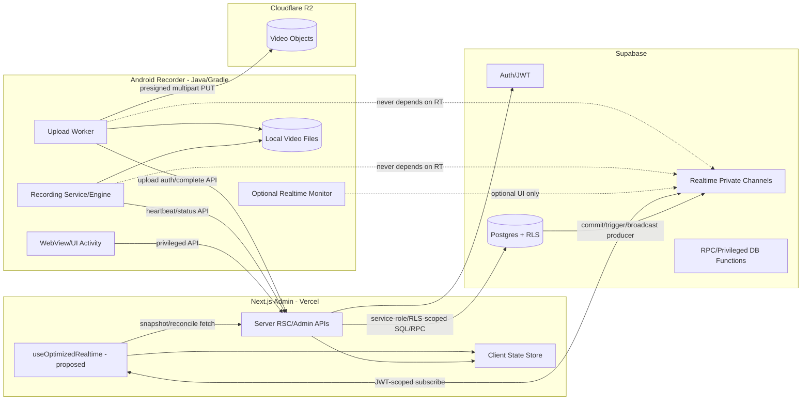

### 3.2 Sequence diagrams

#### A. Android device connects
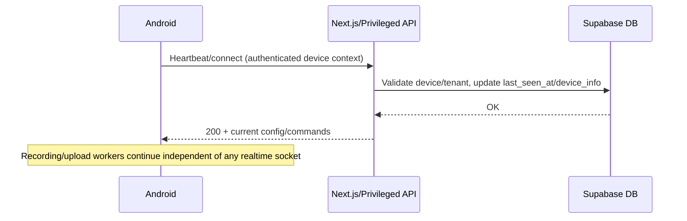

#### B. Admin dashboard loads initial device state
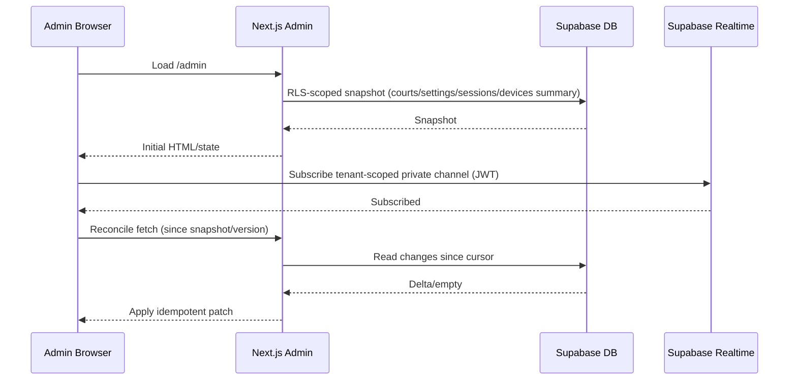

#### C. Android reports camera or recording changes
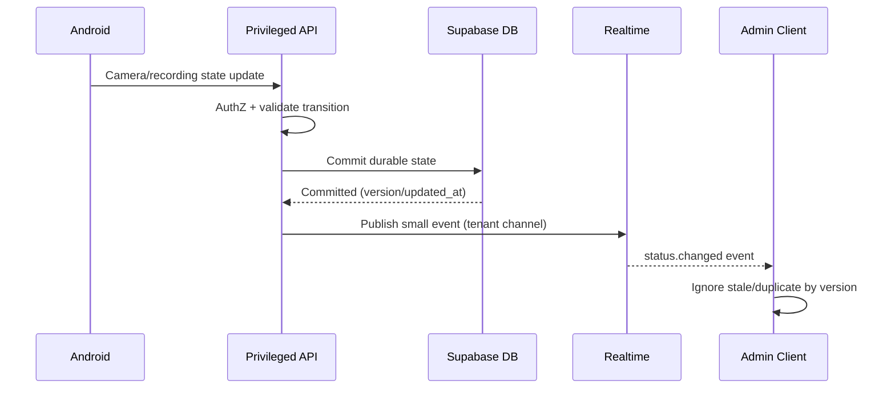

#### D. Realtime updates reach authorized admin clients
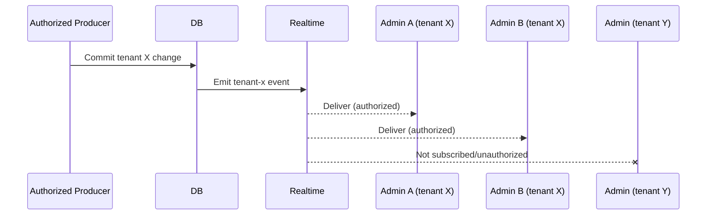

#### E. Device begins a recording
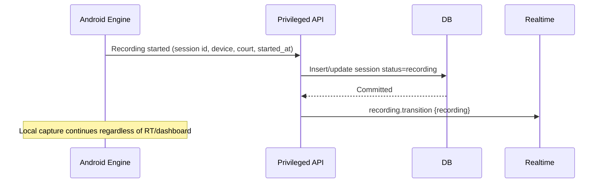

#### F. Local recording finalizes
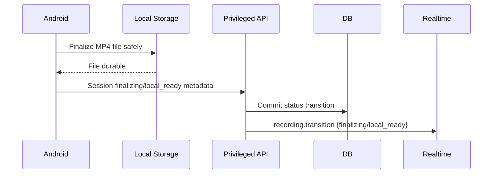

#### G. Background R2 upload progresses
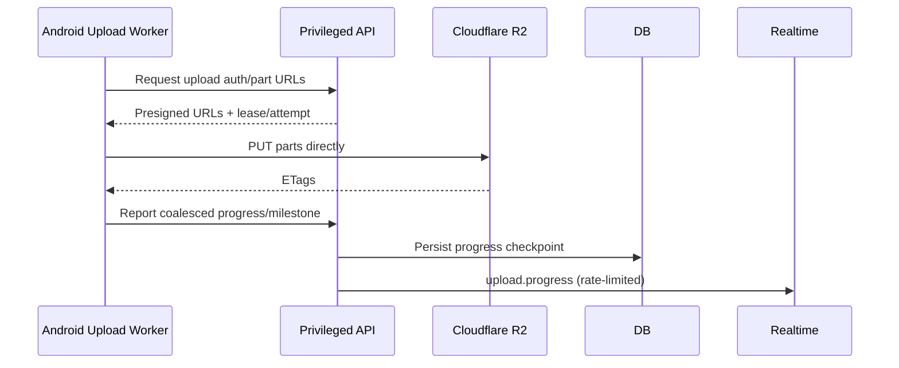

#### H. Upload completes and is verified
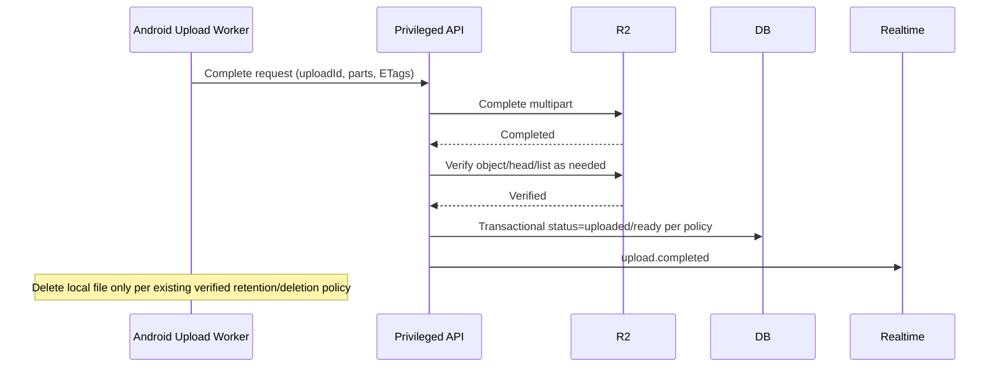

#### I. Android temporarily loses network connectivity
```mermaid
sequenceDiagram
  participant A as Android
  participant Local as Local Disk
  participant API as API
  A->>Local: Continue recording/saving
  A-xAPI: Heartbeat/upload report fails
  A->>A: Bounded backoff, persist queue state
  Note over A: No recording stop; no UI websocket dependency
  A->>API: Reconnect, resume/reconcile
  API-->>A: Resume instructions
```

#### J. Admin dashboard reconnects and reconciles missed events
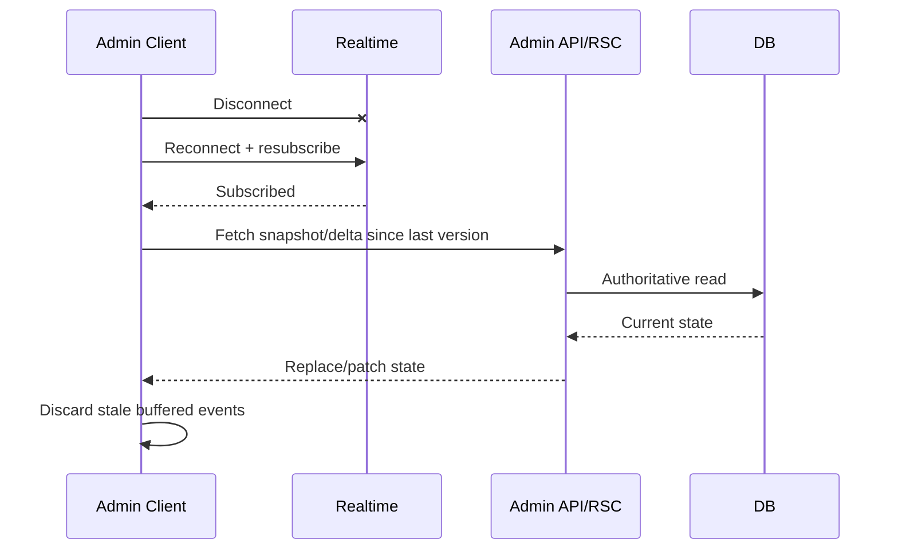

#### K. Multiple tablets update simultaneously
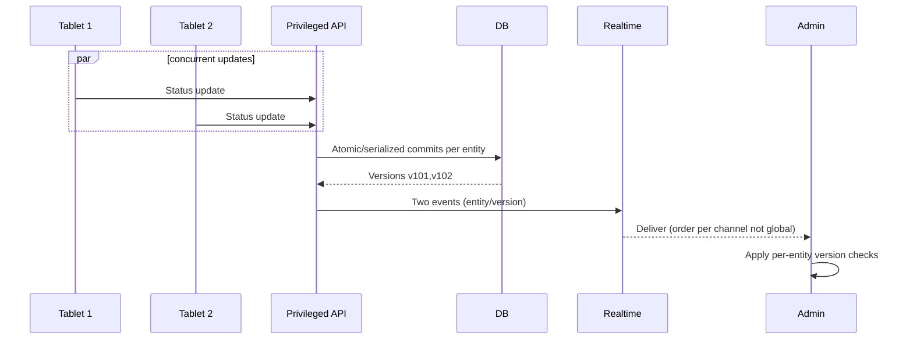

## 4. Subscription/channel design

**Design principle (PROPOSED):** private, authenticated, tenant-scoped channels; smallest useful scope; server-authorized membership; no client-supplied tenant as authorization.

| Channel | Scope / naming (conceptual) | Authorized subscribers | Event source | Payload schema (min) | Max payload | Rate limit | Fan-out | Recovery |
|---|---|---|---|---|---|---|---|---|
| `tenant:{tenantId}:admin-status` | Tenant admins only | Admin JWT with tenant membership/RLS | Server after DB commit | `{type,tenantId,entity,entityId,version,ts,changed}` | 1 KB | 1 msg/5s/entity coalesced; burst 20/min/tenant | 1-3 admins | Resnapshot on gap/reconnect |
| `court:{tenantId}:{courtId}:status` | Optional, if admin filters by court | Tenant admin with court access | Server | `{type,courtId,deviceId,sessionId,status,version,ts}` | 1 KB | 1/10s/device | 1-3 | Reconcile court snapshot |
| `device:{tenantId}:{deviceId}:status` | Optional detail view only | Tenant admin | Server | `{type,deviceId,presence,camera,sessionId,version,ts}` | 1 KB | 1/15s normal, immediate on failure | 1-2 | Fetch device detail |
| `session:{tenantId}:{sessionId}:progress` | Optional recording detail modal | Tenant admin | Server | `{type,sessionId,status,uploadPct?,bytes?,stage,version,ts}` | 1 KB | 1/15-30s progress; immediate terminal | 1-2 | Fetch session snapshot |

**Authorization (PROPOSED):** Supabase Auth JWT required. Use Realtime private channels / RLS-backed authorization per current Supabase-supported model; server validates tenant membership before granting subscription metadata. Do not use public channels for tenant data. **NOT VERIFIED:** exact Supabase channel authorization syntax/config in this project version - confirm against installed Supabase docs before implementation.

**Event type registry (PROPOSED):** `device.presence`, `device.camera`, `recording.transition`, `upload.progress`, `upload.terminal`, `queue.changed`, `email.status`. All include `eventId`, `entityVersion`, `occurredAt`, `tenantId`.

## 5. Auth and RLS requirements

- **VERIFIED (Phase 1/AGENTS):** RLS and tenant isolation are mandatory; privileged operations must remain server-authorized.
- **PROPOSED requirements:**
  - Realtime subscriptions require authenticated Supabase JWT; anonymous access denied.
  - Channel/topic naming includes tenant scope but authorization is enforced server-side/RLS/policy, never by client claim alone.
  - Admin clients can subscribe only to tenants returned by authorized membership.
  - Android devices use device credential/API token flow for privileged APIs; device should not receive broad tenant realtime channels. Optional UI monitor uses user/admin session only if explicitly authenticated.
  - Service-role producers publish only after DB commit; payloads contain IDs/status/minimal metadata, no secrets, presigned URLs, PII, or raw tokens.
  - RLS policies for any readable status tables used by snapshots remain authoritative; realtime does not bypass RLS.
  - Audit privileged mutations (queue cancel/retry/remove, enrollment, settings, email retry) as currently done.

## 6. Android Java reference architecture

**Constraint (VERIFIED):** Android recorder is Java/Gradle; recording and background upload must not depend on active UI WebSocket. Existing app has no runtime realtime subscription.

```java
// Reference only - do not implement as-is without repo verification
interface RealtimeMonitor {
  void start(SessionAuth auth, TenantScope scope); // UI-only
  void stop();                                     // on UI background/close
  boolean isConnected();
}

interface RecordingServiceLifecycle {
  void onRecordingStart(Command cmd);
  void onRecordingStop(Command cmd);
  void onNetworkLost(); // continue local recording
}

interface UploadWorkerLifecycle {
  void enqueue(LocalRecording rec); // durable local queue
  void resumePending();             // boot/reconnect
  void onAuthorizedUpload(UploadGrant grant);
}

final class RealtimeMonitorImpl implements RealtimeMonitor {
  // Owns websocket/client; no reference from RecordingService/UploadWorker.
  // Reconnect with bounded exponential backoff + jitter.
  // Emits UI events on main thread; drops stale versions.
}
```

**Lifecycle rules (PROPOSED):** Activity owns optional monitor; `onStop`/`onDestroy` may stop monitor only. Foreground/service worker owns recording/upload; process restart restores from durable local DB/files. No Kotlin migration. Use existing HTTP/auth stack for essential paths; add realtime library only if Java-compatible and justified.

## 7. Next.js hook reference architecture

```ts
// Reference design only - proposed, not existing code
export type RealtimeEvent<T extends object = Record<string, unknown>> = {
  eventId: string;
  type: string;
  tenantId: string;
  entity: "device" | "session" | "court" | "queue" | "email";
  entityId: string;
  version: number;
  occurredAt: string;
  payload: T;
};

export interface UseOptimizedRealtimeOptions<TSnapshot, TEvent extends RealtimeEvent> {
  tenantId: string;
  channels: string[];
  enabled: boolean;
  getSnapshot: (signal: AbortSignal) => Promise<TSnapshot>;
  applyEvent: (prev: TSnapshot, event: TEvent) => TSnapshot;
  getVersion: (snapshot: TSnapshot) => number | string;
  reconcileIntervalMs?: number; // fallback, e.g. 120000
  onError?: (err: unknown) => void;
}

export function useOptimizedRealtime<TSnapshot, TEvent extends RealtimeEvent>(
  options: UseOptimizedRealtimeOptions<TSnapshot, TEvent>
): {
  snapshot: TSnapshot | null;
  status: "idle" | "loading" | "subscribed" | "reconnecting" | "polling-fallback" | "error";
  lastEventAt: string | null;
  reconcile: () => Promise<void>;
} { /* implementation in Phase 3+ */ return {} as any; }
```

**Behavior (PROPOSED):** authenticate via existing Supabase/browser session; fetch snapshot before subscribe; dedupe by `eventId`; ignore stale `version`; detect gaps and resnapshot; pause/resume on visibility; share channel subscriptions by scoped key; cleanup listeners/timers on unmount; no `router.refresh()` for every event. Preserve existing 30s/15s polling as fallback until realtime proven.

## 8. Supabase database and realtime design

- **Authoritative DB:** keep current tables/RPCs/policies as source of truth. **VERIFIED:** sessions/devices/courts/settings/browser_recordings/email_jobs/cleanup/readiness flows exist.
- **Realtime publication (PROPOSED):** do not expose broad table replication by default. Prefer server-produced Broadcast/private channel events after committed writes, or tightly scoped Postgres Changes only on low-churn status tables/views with RLS. Avoid high-churn heartbeat/progress tables in Postgres Changes.
- **Schema additions (PROPOSED, minimal):** optional `event_version`/`updated_at`/`status_seq` columns on status entities; optional `realtime_events_outbox` only if needed for reliable publish-after-commit (evaluate complexity first).
- **Indexes (PROPOSED):** ensure `(tenant_id, updated_at)`, `(tenant_id, court_id, updated_at)`, `(device_id, updated_at)` for reconciliation queries; avoid `select("*")`.
- **Retention:** keep audit/recovery metadata; prune transient realtime outbox/debug rows with short TTL if introduced.

## 9. Vercel API classification

| Request category | Classification | Rationale |
|---|---|---|
| Admin auth/session/role checks | Authenticated backend / server | Trust boundary; never client-only |
| Initial admin snapshot (`/admin` RSC, list endpoints) | Authenticated backend + RLS-scoped DB | Authoritative snapshot/hydration |
| Tablet summary/full polling (`/api/admin/tablets`) | Optimized polling fallback; possible later partial Supabase+RLS read for non-sensitive summary | Keep until realtime proven; summary already optimized |
| Device mutations (save/disable/remove/enroll) | Authenticated backend | Privileged, audit, same-origin, race checks |
| Upload queue cancel/retry | Authenticated backend/RPC | Privileged state transition |
| R2 upload authorization/presign/complete/verify | Authenticated backend | Security-critical; never bypass |
| Video bytes PUT/GET to R2 | Direct R2 transfer | Do not proxy through Vercel |
| Upload progress heartbeats from Android | Authenticated backend; coalesced | Needed for durability; rate-limit |
| Optional admin UI status updates | Supabase Realtime + polling fallback | Low-volume UX improvement only |
| Recording capture/encoding/file finalize | Android local processing | Must work offline/disconnected |
| Email send/retry/cleanup jobs | Backend/job worker | Privileged/external side effects |

## 10. Capacity and usage budget tables

**Assumptions (ESTIMATED, from Phase 1):** 15-min segments, 150 MB/segment, 5 recording hrs/court/day = 20 segments/day, 7-day retention, 30-day month. Realtime estimates assume selective transition events only; progress events coalesced. Supabase message billing counted as `events * subscribers * channels_delivered` (confirm current Supabase billing semantics before implementation). Safety margin target: <=70% of free-tier allowance.

### Supabase Realtime message estimate (selective transitions)

Formula: `monthly_messages = devices * events_per_device_per_day * admin_subscribers * 30`.

| Scenario | Devices | Admin subscribers | Event rate assumption | Events/device/day (EST) | Monthly messages (EST) | % of 2,000,000 |
|---|---:|---:|---|---:|---:|---:|
| A | 1 | 1 | 30s/coalesced transitions | 120 | 3,600 | 0.18% |
| B | 4 | 2 | 30s/coalesced | 120 | 28,800 | 1.44% |
| C | 10 | 3 | 30s/coalesced | 120 | 108,000 | 5.40% |
| D stress | 20 | 5 | 15s/coalesced | 240 | 720,000 | 36.0% |

High-frequency comparison (not recommended): 1s with same D subscribers = 20*86,400*5*30 = 259,200,000 messages/month (far exceeds 2M). **Conclusion:** 1s/5s status push is not free-tier safe; 15-30s coalesced/milestone-only may be.

### Vercel / Supabase / R2 budget

| Metric | A (EST) | B (EST) | C (EST) | D (EST) | Free allowance (VERIFIED/Phase 1) | Notes |
|---|---:|---:|---:|---:|---|---|
| Supabase concurrent realtime connections | 1-2 | 2-6 | 3-13 | 5-25 | 200 connections | Admins + optional monitors; keep low |
| Supabase realtime messages/mo | 3.6k | 28.8k | 108k | 720k | 2,000,000 | Selective/coalesced only |
| Supabase DB egress/mo | <0.5 GB | <1 GB | <2 GB | <4 GB | 5 GB | Depends on snapshot/poll payloads |
| Supabase DB storage | low growth | moderate | moderate-high | high | 500 MB | Session/log/heartbeat retention can pressure limit |
| Vercel function invocations/mo (polling fallback) | ~90k | ~180k | ~360k | ~720k | Hobby quota not precisely published (NOT VERIFIED) | Assumes few admin tabs; visibility-aware |
| R2 storage GB-month | 90 | 360 | 900 | 1350 | 10 GB-month free | **Exceeds free tier in all scenarios** |
| R2 excess GB-month | 80 | 350 | 890 | 1340 | - | Dominant cost driver |
| R2 Class A ops/mo (EST) | 20,400 | 81,600 | 204,000 | 306,000 | Free allowance generous, exact not published (NOT VERIFIED) | Multipart initiation/parts/complete |

## 11. Billing feasibility assessment

**Classification: D — Cannot guarantee $0 because of billing/provider controls; C for required R2 workload under stated assumptions.**

- **Supabase Realtime/Vercel polling:** potentially within free allowances for small deployments with strict coalescing, low admin concurrency, and reconciliation fallback (B/A possible for messaging). **NOT VERIFIED** without live usage and current account plan enforcement.
- **Cloudflare R2:** modeled scenarios exceed 10 GB-month free storage in all cases; therefore not $0 for required recording workload/retention assumptions. Reducing retention/segment size/count or moving to lower-volume recording can move toward B, but that changes workload.
- **Provider controls:** free-tier allowances are not hard spending caps by default; billing alerts/plan limits/caps must be configured where supported. Vercel/Supabase plan restrictions and commercial-use terms require account-level verification.

## 12. Monitoring thresholds and guardrails

| Area | Threshold (PROPOSED) | Action |
|---|---:|---|
| Supabase realtime messages | 70% of monthly allowance | Disable noncritical progress events, increase coalescing to 60s |
| Realtime connections | 70% of 200 | Disable optional UI monitors, enforce one channel set per admin session |
| Vercel invocations | account-specific 70% budget | Increase polling interval, disable background refresh, manual refresh only |
| R2 storage | 8 GB-month projected | Warn admin; enforce retention cleanup; block new cloud retention extensions |
| Upload retries | 5/part, bounded backoff | Mark failed with actionable error; no infinite retry |
| Event payload | >1 KB avg or >4 KB max | Drop field bloat, send IDs/version only |
| Reconnect storms | >3 reconnects/min/client | exponential backoff + jitter, cap attempts, fallback polling |
| DB growth | 70% of 500 MB | review heartbeat/log retention, archive/prune per policy |

## 13. Failure and fallback strategy

- **Realtime unavailable/rate-limited:** automatic fallback to existing visibility-aware polling; manual Refresh button remains.
- **Missed/stale/duplicate events:** version/eventId checks; gap detection triggers snapshot reconciliation.
- **Auth invalidation:** resubscribe after token refresh; fail closed on authorization errors.
- **Android offline:** local recording continues; durable local queue; bounded retry/backoff; reconcile on reconnect. No dependency on dashboard realtime.
- **Vercel pressure:** reduce poll frequency, disable realtime progress, keep privileged APIs only.
- **R2 quota/cost pressure:** preserve local footage, pause new uploads per policy, surface clear admin state; never delete unverified footage.
- **No infinite loops:** all retries bounded with jitter; circuit-breaker after repeated failures.

## 14. Migration and rollback strategy

Phased, backward-compatible, minimal:

| Phase | Objective | Key changes | Rollback | Complexity | Model rec |
|---|---|---|---|---|---|
| P0 | Instrument/confirm baselines | Add metrics/logging only where safe | disable metrics flags | Low | GPT-5 mini/Codex mini |
| P1 | Snapshot + reconciliation APIs/contracts | Read-only endpoints/selects, version fields | keep polling-only | Med | GPT-5 Codex |
| P2 | Admin selective realtime | `useOptimizedRealtime`, private channels, feature flag | flag off -> polling | Med-High | GPT-5 Codex |
| P3 | Android optional UI monitor | Java monitor isolated from recording/upload | disable monitor | Med | GPT-5 Codex + Android |
| P4 | Guardrails/cost controls | thresholds, coalescing, alerts | revert thresholds | Low-Med | GPT-5 mini |

Each phase requires auth/RLS review, tests, and no change to R2 direct upload, recording engine, queue ownership, or deletion/retention semantics.

## 15. Implementation phases with model recommendations

1. **P0 Audit instrumentation** - GPT-5 mini/high-throughput: collect real poll/message/storage metrics; no behavior change.
2. **P1 Reconciliation contract** - GPT-5 Codex: add versioned snapshot/delta read model; keep existing APIs.
3. **P2 Admin realtime opt-in** - GPT-5 Codex: feature-flagged tenant channel subscription; fallback to polling.
4. **P3 Android optional monitor** - GPT-5 Codex (Java-aware): UI-only realtime; strict lifecycle separation.
5. **P4 Hardening/cost guardrails** - GPT-5 Codex/mini: caps, alerts, dashboards, runbooks.

## 16. Assumptions and unresolved questions

**Assumptions (ESTIMATED/PROPOSED):** workload numbers from Phase 1; Supabase billing counts fan-out as messages; admin concurrency low (1-3); realtime used only for selective transitions; no live usage metrics available in this environment.

**Unresolved (NOT VERIFIED):** actual Supabase/Vercel/R2 account usage; exact Supabase Realtime authorization API for installed version; whether DB storage is already near 500 MB; actual R2 object sizes/count/retention in production; Vercel Hobby invocation limits for this account; commercial-use/billing-cap enforcement on current plans.

## 17. References

- **Phase 1 audit:** `D:\DinkVision V2 Cloudflare R2\dinkVision\agent-handoffs\realtime-phase1-audit.md` (VERIFIED read).
- **Repo evidence (VERIFIED, Phase 1/subagent):** `app/admin/page.tsx`, `components/admin-dashboard.tsx`, `components/browser-tablets-admin.tsx`, `app/api/admin/tablets/route.ts`, `lib/supabase-server.ts`, `lib/recorder-server.ts`, `lib/auth.ts`, `lib/tenant-scope.ts`, `lib/recording-status.ts`, `lib/device-presence.ts`, `lib/camera-health.ts`, `lib/browser-jobs.ts`, `lib/r2-jobs.ts`, `proxy.ts`, `next.config.ts`.
- **Provider docs (VERIFIED as of 2026-11-23 in Phase 1; re-verify before implementation):** Supabase pricing/Realtime limits, Vercel Hobby limits, Cloudflare R2 pricing/limits.

**Verification note:** This report is design-only. No source files, migrations, dependencies, or production data were modified. Stop after Phase 2 report creation.