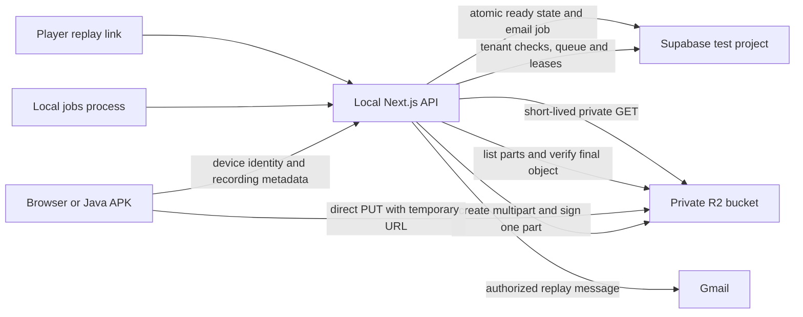

# R2 local integration

Target: Supabase `gwermdkkrotvvpoxkqdx`, Cloudflare account `42c7c9ce788292c080caf0ad3e8daded`, private Standard/APAC bucket `dinkvision-videos-dev`.

New browser and Java Android recordings use R2. Existing Drive recordings and links remain intact. Gmail remains the mail provider. Do not run migrations against the original project.

## Phases and exit criteria

1. **Baseline and trace:** identify capture, validation, queue, upload, playback, email and cleanup paths. Pass baseline TypeScript and tenant/database tests.
2. **Isolated local configuration:** explicit local scripts load only `.local/r2-test.env`, reject another Supabase project/bucket or a public application origin, and never inherit production credentials. Server secrets remain outside source control.
3. **Identity and test database:** bootstrap existing migrations into the empty test project; resolve active tenant membership during sign-in; provision accounts with explicit membership. Verify cross-tenant denial.
4. **R2 schema:** additive storage metadata and upload attempts; atomic completion, constraints, indexes and explicit grants/RLS. Preserve historical Drive metadata.
5. **Upload API:** versioned `r2-multipart-v1`; sequential 8 MiB parts; server-authorized part URLs; R2-confirmed resume offsets; serialized prepare/finish/restart; idempotent verified completion; cancellation preserves local footage.
6. **Browser:** direct upload using bounded blobs; retry/resume from server truth; do not discard local video before verified completion.
7. **Android:** Java streaming uploads, bounded buffers/timeouts, interruption/retry handling, strict signed-URL validation; build a separate debugLocal APK and checksum.
8. **Playback and Gmail:** authenticated admin/player playback and expiring guest replay links; short-lived private R2 URLs; Gmail-only OAuth independent of Drive; local replay links use the PC LAN origin.
9. **Admin and jobs:** expose storage/email status independently; reconcile interrupted completion; delete only expired R2 objects; abort abandoned attempts; preserve old Drive links.
10. **Cleanup and automated verification:** remove Drive assumptions from active browser/APK flows; focused regression, permission and failure tests, typecheck, web build, Android tests/build and final diff review.
11. **Client acceptance:** start with the Android emulator, then PC browser and Android phone/USB OTG camera; ADB reverse port 3000; record over one minute, interrupt/retry upload, play/download, test denied/expired links. Hardware and actual Gmail delivery require explicit observed results.

## Local environment

The application is local, while the explicitly selected test Supabase project and R2 bucket are hosted. At the user's request on 22 November, the root `.env` was updated to match the verified `.local/r2-test.env` configuration; the previous file is backed up privately as `.local/env-before-r2-20261122-1795293953393.env`. Gmail credentials remain unset. Prefer `npm run dev:r2`, `npm run jobs:r2`, and `npm run db:migrate:r2` for their explicit destination checks. Build Android with `assembleDebugLocal` when using the local HTTP origin.

MCP authentication is separate from application credentials. The application needs a bucket-scoped R2 S3 Access Key ID/Secret Access Key, the test project's Supabase secret key, and (for direct CLI migrations) its database connection string. Gmail needs its OAuth client configuration and a fresh consent for this test project. Never paste secrets into chat.

## Implementation status — 22 November 2026

Phases 1–10 have implementation and automated checks. Live Supabase sign-in, admin API reads, multipart storage transfers, replay downloads and retention cleanup pass. Both an emulator recording and an 82-second Galaxy A22/EMEET recording passed capture, branding, upload, server confirmation and local-copy cleanup; their replay downloads decoded fully. The physical recording survived an offline app restart before upload. Browser camera capture, additional hardware scenarios and Gmail delivery remain pending. Synthetic API, emulator and physical-device results are separate evidence.

| Area | Implemented and verified | Remaining acceptance |
| --- | --- | --- |
| Services | Runtime Supabase and R2 credentials verified again on 21 November. R2 is private, APAC, Standard. Local CORS is configured. | Complete client/hardware acceptance remains; MCP availability is separate from runtime access |
| Database | 64 historical migrations plus 3 R2 migrations applied to the test project; 67 ledger entries. RLS and server-only completion/cleanup RPCs checked. | Admin sign-in verified; separate player-account acceptance pending |
| Upload | Browser and Java APK support direct 8 MiB multipart transfers, server-confirmed resume, leased retries, idempotent completion, inspection/cancellation guards. Emulator and physical APK transfers passed, including recovery after an offline stop and app restart. | Browser capture and interruption during an individual part transfer |
| Playback | Tenant-authorized playback and signed guest links; active tenant, ready file and expiry checked; private GET URLs expire within 5 minutes. Emulator replay decoded fully; extracted frame shows DinkVision watermark. | Interactive playback and seeking on browsers/physical phone |
| Email | Gmail-only OAuth, encrypted per-tenant refresh token, existing send deduplication and ambiguous-send handling. | Connect test sender and explicitly test delivery |
| Admin/jobs | Tenant-scoped status, independent storage/mail health, interrupted-completion recovery, abandoned-upload abort, atomic expiry confirmation. | Live expiry cleanup passed; additional interruption/concurrency scenarios remain |
| Android | Local APK built, lint passed; emulator enrolled and captured an 80-second recording; 18 targeted instrumentation tests passed. Galaxy A22 / Android 13 and EMEET C60E completed an 82-second upload/recovery test; picture/audio confirmed by the user. OPPO CPH2849 / Android 17 enrolled separately. | OPPO acceptance in progress; built-in-camera start-time mismatch and intermittent emulator timing remain unresolved |
| Code | TypeScript check and Next.js production build passed. Full regression suite: 225 passed; 5 additional R2 boundary tests passed. | Live integration acceptance below |

The test project now has the owner-authorized admin account and a synthetic integration-test recording whose R2 object was removed by retention cleanup. Its test court/device/kiosk are disabled; diagnostic history remains. No test message was sent. Historical Drive recordings were not migrated or deleted.

Next.js was updated from 16.3.6 to 16.4.6 after the dependency audit identified critical advisories. The post-update audit reported zero vulnerabilities. Changes are on `codex/r2-local-integration`; `origin` points to `senpaiking07-arch/dinkvision-V2`. No GitHub push or deployment has been performed.

## Data flow and failure handling



- Supabase owns identity, tenancy, recording state, metadata and jobs. R2 owns video bytes. The APK/browser never receives the Supabase secret key or R2 credentials.
- A part PUT is not completion. The API verifies contiguous part sizes, final object size/type/metadata and the active lease before committing the file, session and email job together.
- Lost completion responses are reconciled with an R2 HEAD request. The local recording is retained until server-confirmed completion. Cancellation and footage requiring inspection cannot be overridden by the worker.
- Expired-object deletion can be retried if its response is lost. File/session deletion state and the audit event commit together. Historical Drive objects stay on their existing path.
- Inactive multipart attempts are aborted by the worker after 24 hours. The bucket's existing 7-day incomplete-multipart lifecycle also covers create responses lost before an upload ID can be saved.
- Cleanup is eventual: replay access stops at expiry even if the PC worker is offline; physical object deletion waits until a worker runs successfully.
- Signed guest links are bearer links: anyone possessing a valid link can view until expiry. Admin/player account playback additionally uses Supabase authorization. R2 is object storage; this integration does not add adaptive streaming or server-side transcoding.

## Finish the private local configuration

Edit `.local/r2-test.env` in the checkout. It is ignored by Git. Do not put secrets in chat, browser JavaScript, APK build configuration, or `.env.example`.

| Variable | Where to obtain it |
| --- | --- |
| `SUPABASE_SECRET_KEY` | The **test** project's [API keys settings](https://supabase.com/dashboard/project/gwermdkkrotvvpoxkqdx/settings/api-keys): server secret key, not the publishable key |
| `R2_ACCESS_KEY_ID` and `R2_SECRET_ACCESS_KEY` | Cloudflare R2 → Manage R2 API Tokens → create an **Object Read & Write** token restricted to `dinkvision-videos-dev`; use its S3 access-key pair |
| `GOOGLE_CLIENT_ID`, `GOOGLE_CLIENT_SECRET` | Google Cloud OAuth web client with Gmail API enabled; needed for mail only |
| `GOOGLE_SENDER_EMAIL` | The test sender whose Google account will grant consent; may also be set per tenant in settings |
| `MIGRATION_DATABASE_URL` | Optional for subsequent local migration commands; test-project Postgres connection string. Already-applied MCP migrations do not require it to start the app. |

The project URL, publishable key, account ID, bucket, local origins, and random encryption/replay/cron secrets have already been written locally. Preserve the generated keys: changing encryption keys invalidates stored Google credentials; changing the replay key invalidates existing links.

MCP OAuth authorizes this coding session to manage the services. It does not supply runtime S3 credentials or a Supabase server secret to Next.js. Never use a Cloudflare dashboard API token directly as an S3 secret.

Current origins:

- `APP_ORIGIN=http://127.0.0.1:3000` for sign-in, admin, capture and Android through ADB reverse.
- `REPLAY_ORIGIN=http://192.168.1.9:3000` for players on the same private network. Update this if the PC address changes.
- `GOOGLE_REDIRECT_URI=http://127.0.0.1:3000/api/integrations/google/callback`; register this exact callback in Google Cloud and use the matching admin origin.
- Bucket CORS permits `http://localhost:3000`, `http://127.0.0.1:3000`, and `http://192.168.1.9:3000`. Add only the required test origin if the LAN address changes.

Local commands deliberately reject another Supabase project, another bucket, public application origins and mismatched callback URLs. They clear inherited application environment variables before Next.js loads its `.env` files. A build can run without privileged secrets; starting the app or jobs fails early if required runtime credentials are missing.

## Run the app, admin and worker

Before starting, run `npm run check:r2`. This read-only check reports all missing runtime keys, validates the isolated destinations, and checks Supabase server reads and R2 bucket access when credentials are present. It never prints key values or writes remote data. A passing preflight does not prove uploads, Gmail delivery or hardware capture work.

From this checkout in PowerShell:

```powershell
npm run dev:r2
```

Open `http://127.0.0.1:3000`. In a second terminal, with the same working directory:

```powershell
npm run jobs:r2
```

The worker checks approximately every 30 seconds, with bounded operations and retries. Keep both processes running while testing uploads, email and retention. Local replay links work only while the PC is reachable on that network. Browser camera capture should use localhost; plain LAN HTTP is not a secure camera context.

Create a test account only for an address you control, replacing the example address and name:

```powershell
npm run account:create:r2 -- your-test-email@example.com admin "Test Admin" 00000000-0000-4000-8000-000000000001
```

The command creates a verified test account and tenant membership without sending email. It saves the random password under `.local/account-<user-id>.json`, never prints it, and never resets an existing account's password. Use role `player` for a separate player test account.

In Admin, configure the court/device, enroll the recorder and confirm camera setup. Configure the Gmail sender and connect Gmail when testing mail. Use only recipient addresses you control for acceptance recordings; confirmed recordings can queue automatic replay mail once Gmail is connected.

## Local APK and physical device setup

Artifact: `../DinkVision-APKs/Dink-Vision-Recorder-0.5.48-r2-local.apk`, with a sibling `.sha256` file. Package ID: `com.casabatik.recorder.dev`. The local variant uses this workstation's normal Android debug key and `http://127.0.0.1:3000`. Hosted signing overrides are preserved for their own variant.

Rebuild from the `android` directory:

```powershell
.\gradlew.bat :app:assembleDebugLocal :app:lintDebugLocal :app:assembleDebugLocalAndroidTest
```

With a physical device connected to ADB, replace `DEVICE_SERIAL` with its listed serial:

```powershell
adb devices -l
adb -s DEVICE_SERIAL install -r "..\DinkVision-APKs\Dink-Vision-Recorder-0.5.48-r2-local.apk"
adb -s DEVICE_SERIAL reverse tcp:3000 tcp:3000
```

These install/reverse commands assume the repository root. Add the Android SDK's `platform-tools` to PATH or invoke its `adb.exe` explicitly. If the phone's USB port is occupied by the OTG camera, pair wireless debugging first using the address and pairing port displayed on the phone:

```powershell
adb pair PHONE_IP:PAIRING_PORT
adb connect PHONE_IP:DEBUG_PORT
adb -s PHONE_IP:DEBUG_PORT reverse tcp:3000 tcp:3000
```

Use the phone's displayed values; pairing and debugging ports can differ. Keep the phone and PC on the same Wi-Fi. Do not uninstall an existing recorder to solve a signing mismatch while it contains unsynced footage.

## Acceptance checklist

Run each case with both browser and APK where applicable; record observed results rather than assuming success from compilation.

1. Sign in as admin/player, switch an authorized tenant, and confirm foreign-tenant data and device actions are denied.
2. Enroll the device, verify camera/audio permissions and configuration. On physical USB/UVC hardware, confirm preview, audio routing, orientation and reconnect behavior.
3. Record at least 65 seconds, stop, and confirm the existing branding/validation policy completes. Recordings under one minute follow the existing local-only policy.
4. Observe a private R2 object and matching ready Supabase metadata. Verify admin progress and player availability. Confirm no credentials appear in client responses or logs.
5. Interrupt Wi-Fi during a multipart upload; restore it and confirm resumption from storage-confirmed bytes. Restart the app during retry and verify the local backup survives.
6. Cancel, retry, and duplicate completion requests. Confirm a single authoritative file/email job; test capture interruption that requires inspection.
7. Play, seek and download from admin/player and the guest link. Test expired, tampered, removed-file and disabled-tenant links. Validate playback after several minutes, when an earlier R2 URL has expired.
8. Connect Gmail and explicitly send a replay to your own test inbox. Confirm one message with the LAN replay link. Review ambiguous delivery manually rather than resending automatically.
9. Set a short retention interval for a new test recording. Observe denied playback at expiry, later remote deletion, and matching file/session/audit state. Interrupt cleanup and verify safe recovery.
10. Test legacy Drive playback separately before any future deployment using historical data. Test storage quotas, concurrent devices, low disk space and long recordings before expanding beyond local evaluation.

## Verification records and remaining findings

- `.local/r2-regression-final.log`: 225 passing regression tests.
- `tests/r2-boundaries.test.ts`: 5 additional passing tests covering route access, SDK signing, pagination, guest replay and passive recovery probes.
- `.local/r2-android-tests.log`: 18 passing emulator tests across R2 upload, existing transfer, legacy direct upload and failure recovery.
- `.local/r2-android-build.log`: debugLocal APK, Android test APK and lint successful.
- `.local/r2-web-build.log`: Next.js 16.4.6 production build successful; TypeScript check also passed.
- Supabase security advisor: no error-level findings. Intentional server-only tables have no client RLS policies ([explanation](https://supabase.com/docs/guides/database/database-linter?lint=0008_rls_enabled_no_policy)); six existing authenticated security-definer helpers remain callable for membership/RLS/player status ([review guidance](https://supabase.com/docs/guides/database/database-linter?lint=0029_authenticated_security_definer_function_executable)). Anonymous helper execution was revoked. Completion and cleanup RPCs are not client-callable.
- Live test results: `.local/r2-live-storage-result.json` (multipart, CORS, checksum, range requests, unsigned denial and cleanup), `.local/r2-live-admin-result.json` (sign-in and authenticated admin endpoints), and `.local/r2-live-app-result.json` (real upload API, database completion, replay access, expiry and worker cleanup).
- Emulator capture: `.local/r2-emulator-recording.json` and `.local/r2-emulator-replay-result.json` record the successful 80.023-second capture and 3,621,253-byte R2 replay. `.local/r2-emulator-replay.mp4` retains the downloaded test-pattern video; `.local/r2-emulator-replay-frame.png` shows the DinkVision watermark. The stored audio track decoded, but audibility was not verified in the headless, muted emulator.
- On 21 November the worker confirmed the previous emulator object's retention deletion, including `recording_files.status=deleted` and `deleted_at`. The local replay artifact remains available for inspection.
- `.local/r2-android-nov21-build.log`: rebuilt debugLocal APK and lint passed after setting the session's Android SDK path. `.local/r2-android-assets-nov21.log`: 6 focused UI regression tests passed. Saved-videos wording was checked in the installed APK.
- `.local/r2-phone-usb-test.log`: one passing physical EMEET capture test, after accepting the Android USB permission prompt. The prior attempt timed out waiting for that prompt; it was not a successful camera test. The app's later camera check measured approximately 29.8 fps at 1280×720 despite a 60 fps requested profile; do not report this as validated 60 fps. The user confirmed clear picture and audio.
- `.local/r2-phone-final-build.log`: clean debugLocal APK and lint passed; temporary timestamp diagnostics were removed. The built-in-camera-only probe was skipped because a USB camera was connected, so it does not establish built-in capture correctness.
- `.local/r2-phone-offline-ui.json` and `.local/r2-phone-offline-restart-ui.json`: Galaxy A22 retained a branded 71,936,786-byte recording with retry status while ADB reverse for backend port 3000 was removed, including after force-stopping and reopening only the local-test app. Restoring that mapping resumed upload; nine multipart parts completed. This tests backend unavailability before transfer, not a Wi-Fi interruption during a part PUT.
- `.local/r2-phone-replay-result.json`: the physical replay downloaded through the guest endpoint and all video/audio frames decoded; fresh admin sign-in and the admin device API confirmed ready/uploaded state. Supabase reported R2 storage and `local_available=false`; the APK's Saved videos list was empty only after completion. The first download check timed out at 30 seconds; the retry with a longer bounded test-download timeout passed. Gmail failed safely as unconfigured; no test email was sent.
- Local directory maintenance removed stale test folders, old APKs/screenshots and SHA-256-identical video downloads, freeing 667 MB. Older scripts, evidence and unique recordings are preserved in `.local/archive/legacy-debug/`; credentials and `.local/device-backups/` remain intact. `recorder/cleanup.test.mjs` now removes its temporary directory after every test; the focused test passed with no leftover cleanup-test folders.
- Remaining: browser capture/branding and UI playback, physical APK/camera acceptance, Gmail OAuth and delivery, plus broader interruption/concurrency testing. Runtime Supabase and R2 credentials are verified. Short emulator camera checks sometimes fail the existing timing validation; do not treat a successful retry as proof that this is resolved.

## Before any future deployment

Use separate production credentials/configuration, an HTTPS replay origin, correct CORS and OAuth redirects, a scheduled authenticated worker, current database migrations, a supported APK rollout, monitoring and a backup/recovery plan. Re-test existing Drive playback and tenant isolation. Do not point this checkout's local helper scripts at production. This work does not deploy or migrate historical videos.

The [application quality guide](application-quality-guide.md) defines the eight quality traits, implementation examples and measurable acceptance goals.

## Current local session

The app and `jobs:r2` were restarted on 21 November at `http://127.0.0.1:3000`. Logs are `.local/r2-dev.log` and `.local/r2-jobs.log`; development request logs may contain replay bearer links, so keep them private. The test admin is `senpaiking07@gmail.com`; its generated password is saved only in `.local/account-5d9fb324-59a9-4b99-8f40-58f1855d0bb0.json`. No password is printed in chat. Emulator `DinkVision_Upgrade50` uses package `com.casabatik.recorder.dev`; restore `adb -s emulator-5554 reverse tcp:3000 tcp:3000` whenever the emulator or ADB daemon restarts.
